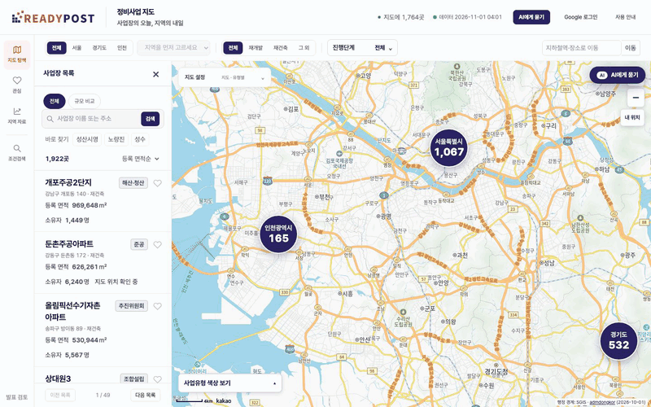
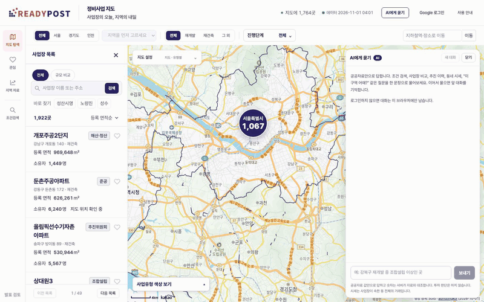
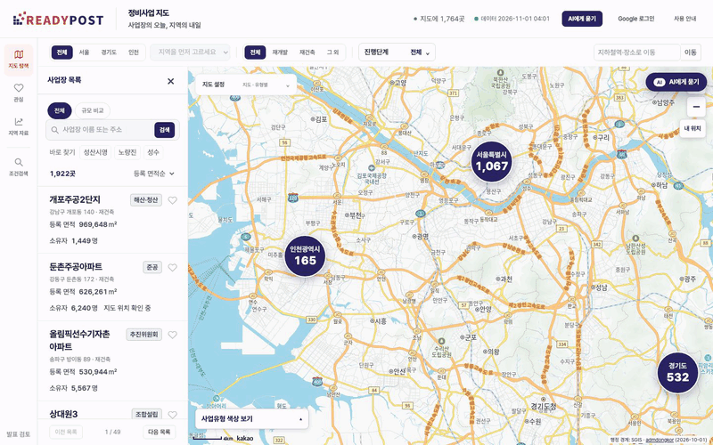

# readypost — 정비사업 데이터 통합 지도 서비스

흩어진 재개발·재건축 공공데이터(서울·경기·인천)를 모아 정리하고, 지도 위에서 찾아보고 AI에게 물어볼 수 있게 만든 서비스입니다.
㈜레디포스트와 협업한 프로젝트로, 개발팀이 8주(2026.09~10) 동안 만들었고, 저는 **데이터 파이프라인·API·AI·서버 운영**을 맡고 화면 일부도 만들었습니다.

## 데모

### 1. 지도 → 사업장 상세

시군구 버블 → 마커 → 상세(AI 해석·근거·경계) → 진행현황 타임라인 → 동 실거래

### 2. AI에게 묻기

조건 검색 → 이어 묻기 → 화면 조작 → 투자 질문은 판단 대신 자료 안내

### 3. 문장으로 찾기 → 비교

문장을 조건으로 해석 → 표 → 두 사업장 비교

> GIF가 작게 보이면 이미지를 클릭해 원본 크기로 볼 수 있습니다.

## 한 일

8주 동안 약 60개의 PR을 올렸습니다. 영역별로 정리했습니다.

### 1. 데이터 파이프라인 (raw → staging → cleaned → curated)

- 서울·경기·인천 자료를 지역별로 따로 쌓고, 합치는 것은 `zones` 뷰에서만 하도록 설계했습니다. 컬럼을 버리지 않고(합집합), 같은 구역의 여러 레코드는 지우지 않고 1:N으로 묶어 화면에는 대표 1건을 보여줍니다.
- 원문 컬럼은 건드리지 않고 `std_*`·`addr_*`·`zone_key` 컬럼을 옆에 붙이는 방식으로 표준화했습니다. 진행단계 매핑은 CSV 한 곳에서만 바꿉니다.
- 경기 사업 목록을 팀 정리본에서 **경기도 공표 원본**(분기별 첨부 2개)으로 바꿔 직접 만들도록 했고, 서울 사업 목록도 팀 통합본에서 **정보몽땅 목록·사업개요**로 교체했습니다(구역 id 유지, 골든 응답 22개 비교).
- 추진이력의 제각각인 날짜 표기를 표준화했습니다(경기 2,695행 중 2,617행 해석).

### 2. 자동 수집과 지오코딩

- 정보몽땅(목록 엑셀 25개·사업장 페이지·사업개요), 경기도청 공표 게시판, 인천 공공데이터포털, 서울 열린데이터광장을 **새 자료가 올라오면 스스로 받는** 수집기로 만들었습니다. 요청 간격, 이어 받기, 20시간 캐시를 넣었습니다.
- 국토부 실거래(연립다세대·단독다가구·아파트) 약 131만 건을 법정동 단위로 구역에 연결했습니다.
- 지오코딩 캐시와 본번 대체를 구현하고, 도로명 되묻기로 생긴 **틀린 좌표 39건을 찾아 정정**했습니다. 지도 표시 비율은 질의 정리로 42곳을 더 살려 91.9%까지 올렸습니다.
- 서울 구역 경계(SHP) 2,776건을 좌표계만 바꿔 적재하고 구역과 연결했습니다(공공누리 4유형이라 도형은 고치지 않고 출처 표시).
- 해외(시드니) 서버에서 경기도청 요청이 며칠째 시간 초과되는 문제의 원인을 찾아 keep-alive로 고쳤습니다.

### 3. 검증과 안전한 공개

- 53개 검증 항목, 직전 통과 실행보다 행 수가 10% 넘게 줄면 실패하는 급감 검사, 단계가 예외로 멈춰도 어디서 왜 멈췄는지 남기는 실행 기록.
- 새 표를 작업 스키마(`build`)에 만들고 **검증을 통과했을 때만** 한 트랜잭션으로 `public`에 옮깁니다. 실행 중 75번 조회해 전부 직전 숫자였고, 검증을 일부러 실패시켜 `public`이 바뀌지 않음을 확인했습니다. 공개 파일(`zones.json`, 지도 HTML)도 같은 규칙입니다.
- 테스트가 잡아낸 경기 3분기 자료행ID 중복(촉진구역 40곳의 이력이 섞임)을 고치고 중복 검증 항목을 추가했습니다.

### 4. DB와 API

- **SQLite에서 PostgreSQL로 이전**했습니다. 이전 전후 골든 응답 16건을 비교해 차이 0건을 확인했고, 연결을 쥐고 있으면 파이프라인의 `DROP TABLE`이 영원히 기다리는 문제를 겪어 요청마다 열고 닫는 방식으로 정했습니다.
- 읽기 전용 FastAPI 서버를 **명세를 먼저 쓰고** 구현했습니다. 필드·파라미터는 camelCase로 통일하고(v1), 필터는 전부 SQL `WHERE`로 처리합니다.
- 지도·목록·상세·시군구 집계·인근 구역·실거래·시세·구역 비교·조건 검색(스크리너)·단계 소요기간·단계 전후 시세 분석 API, 실행 중에도 직전 데이터를 돌려주는 구조. 테스트 100건 이상(실제 DB 컨테이너 사용).

### 5. AI 기능

- **자연어 조건 검색**: 문장을 검색 조건으로 바꾸고 표준값 검사기로 틀린 값은 되묻기로 바꿉니다. 평가셋 110문(검색·되묻기·거절·프롬프트 주입)을 먼저 만들었고, Opus에서 100%였습니다. 모델별 정확도·지연·비용을 재서 기본 모델을 골랐습니다.
- **대화 패널**: Claude가 읽기 전용 도구를 불러 그 결과만으로 답하고, 표는 화면이 그립니다. 근거 검증기가 답의 숫자·날짜를 도구 결과와 대조해 확인되지 않은 값을 알립니다. 투자 질문은 거절하지 않고 판단 대신 사실을 안내하며 금지 표현을 검사합니다.
- **미리 만든 해석과 시군구 브리핑**: 밤에 사실만 DB 뺄셈으로 계산하고 AI는 문장만 쓰며, 검증에 실패하면 규칙 문장으로 대체합니다.
- **변경 감지 요약**(어제와 견준 새 구역·단계 변화를 슬랙 한 문단으로), **읽기 전용 MCP 서버**(도구 11개), **Google 로그인과 대화 이력 저장**(쓰기는 별도 스키마 하나뿐), 화면을 조작하는 도구(지도 이동·필터·비교).
- 고시문에서 단계 날짜를 뽑아 공표 날짜와 대조하는 파일럿(후보가 있는 항목의 정확도 79%).
- 평가와 측정: 남이 만든 50문을 사람이 채점해 틀림 0·맞음 94%를 확인하고, 검증기가 못 잡던 영어 작업 메모 노출을 찾아 고쳤습니다.

### 6. 화면 일부

- 프론트를 API에 연결하고 목록·요약·서버 상태 화면, 진행현황 타임라인, 시군구 버블, 인근 구역, 실거래 탭, 시세 배지, 구역 비교, 분석 도구 화면, AI 패널(스크롤·삭제·마크다운 표·생성 중 표시)을 만들었습니다.

### 7. 운영과 인프라

- AWS EC2에 DB·파이프라인·API를 올리고 **매일 새벽 자동 실행**, 실패·성공 슬랙 알림, 아예 안 돈 날을 잡는 침묵 감시, `pg_dump` 백업과 복원 절차를 만들었습니다(새벽 실행 14/14 성공).
- 서버를 코드로 옮겼습니다: Dockerfile, compose, Ansible, OpenTofu(EC2 import, S3, CloudFront).
- GitHub Actions CI(doctest, 오프라인 pytest, 문서 검사, 프론트 테스트·빌드)와 KPI 7개 측정, 운영 반영 절차 문서화.

## 숫자 (2026-10 측정 기준)

| 항목 | 값 |
|---|---|
| 사업장(구역) | 약 1,900개 |
| 실거래 | 약 131만 건 |
| 새벽 자동 실행 성공 | 14/14 |
| AI 검색 평가(110문) | 100% (Opus) |
| 남이 만든 50문 사람 채점 | 맞음 94% · 틀림 0 |

## 한계

- 실거래는 구역 경계가 아닌 법정동 단위입니다.
- 지도 표시 91.9%(좌표를 못 찾은 구역이 있음).
- 서울 이력은 추진 중인 사업만 있습니다.

## 기술

Python · pandas · FastAPI · PostgreSQL · Docker · React · TypeScript · Claude API · MCP · AWS(EC2)

> 이 저장소는 소개용입니다. 제품 전체 코드는 협업 저장소에 있어 공개하지 않으며, 설계 판단과 코드 발췌는 글로 정리할 예정입니다. 화면의 서울 경계는 서울시 서울플랜+(공공누리 4유형) 자료이며, 사업 정보는 각 기관의 공공데이터를 가공한 것입니다.
